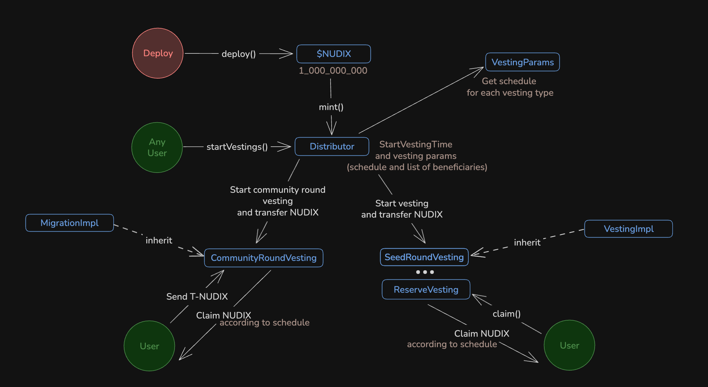

# Nudix

The Nudix project is conducting an early public sale of the T-NUDIX token and vesting NUDIX token.

## Smart Contract Overview

Two smart contracts have been implemented:

**Public Sale:**
- [TemporaryNudix.sol](./src/publicSale/TemporaryNudix.sol). ERC-20 standard temporary token.
- [NudixSale](./src/publicSale/NudixSale.sol). A public sale process for the temporary token.

**Vesting:**
- [Distributor](./src/vesting/Distributor.sol). Maincontract of the locking NUDIX token after minting. Createvesting contracts and distribute NUDIX to them.
- [MigrationImpl](./src/vesting/MigrationImpl.sol). Implementation of the vesting for community round
- [VestingImpl](./src/vesting/VestingImpl.sol). Implementation of the vesting for other allocation groups(liquidity, team, ecosystem, etc)
- [VestingParams](./src/vesting/VestingParams.sol). Params of the vesting for creating

**Token:**
- [Nudix.sol](./src/Nudix.sol). ERC-20 standard permanent protocol token.

## Audits

You can find audit report under the audits folder:

**Public Sale:**
- [Beosin](./audits/Beosin.pdf) (May 29th, 2025)

### Build and test

The project was implemented using the [Foundry framework](https://book.getfoundry.sh/).

```shell
$ forge build
```

```shell
$ forge test
```

## Nudix overview

Smart contract implements a simple fungible protocol token. Which in the future will be issued to users in place of a T-NUDIX. ERC-2612: Permit extension for EIP-20 signed approvals support added.

## Public sale

### TemporaryNudix overview

The smart contract implements the following features:
- Token minting via the mint and mintBatch functions, accessible only to accounts with specify role.
- Restricted token transfers, allowing transfers only to whitelisted addresses (intended for future migration to the permanent NUDIX token via a dedicated smart contract).
- ERC-2612 support: Permit extension for EIP-20 signed approvals.
- Cap to the supply of tokens (1_000_000_000)
- Token burning, permitted only for whitelisted accounts.

### NudixSale overview

The smart contract realizes T-NUDIX public sale and implements the following features:
- Flexible sale round creation by accounts with a dedicated role, allowing configurable parameters: start time, round rate (or pricing), cap, and minimum purchase. The number of rounds is not limited. But there can only be one active round.
- Manual sale round closure by authorized accounts.
- Automatic sale round closure upon reaching the predefined round limit.
- T-NUDIX purchase functionality for participants during active sale rounds.
- The payment token address must be set at the time of contract deployment.

_Important!_ The smart contract does not hold any assets. During the purchase process, it mints T_NUDIX to the buyer and transfers the payment tokens directly to the wallet address that was set during the smart contract deployment."

### Defining the ROUND_RATE parameter for the start of a round

_Note_: USDT may have either 6 or 18 decimals depending on the network (e.g., 6 decimals on Ethereum mainnet, but 18 on BNB Chain)

For this example, assume USDT has 6 decimals, and T-NUDIX has 18 decimals (standard)

Goal: establish a 1:1 exchange rate (1 USDT -> 1 T-NUDIX).

The formula used in the contract to get the token payment amount is `paymentAmount = (amount * roundRate) / TOKEN_SCALE`, where:
  - `paymentAmount` -> USDT.
  - `amount` -> T-NUDIX.
  - `TOKEN_SCALE` -> 1e18 (constant is set to 1e18 to normalize rates to 18 decimals).

We want to receive 1e18 T-NUDIX tokens. How much USDT should be spent? -> 1e6 (i.e. 1 USDT in 6-decimal format).

Plug into the formula: (1e18 * roundRate) / 1e18 = 1e6.
Then roundRate = 1e6.

Therefore:
  - If USDT has 6 decimals, use roundRate = 1e6 for a 1:1 exchange
  - If USDT has 18 decimals, use roundRate = 1e18

### Deploy

Deployment of smart contracts is supposed to be via a deployment script from `/script` folder.

1. Create `.env` file.
2. You need to add the deployer's private key to `.env` according to `.env.example`.

**Deploy Nudix.sol**
```shell
$ forge script script/publicSale/DeployNudix.s.sol --rpc-url <RPC_URL> --etherscan-api-key <API_KEY> --sig "run(address)" "<recipient_address>" --slow --broadcast --verify
```

**Deploy TemporaryNudix.sol**
```shell
$ forge script script/publicSale/DeployTemporaryNudix.s.sol --rpc-url <RPC_URL> --etherscan-api-key <API_KEY> --sig "run(address)" "<admin_address>" --slow --broadcast --verify
```

**Deploy NudixSale.sol**
```shell
$ forge script script/publicSale/DeployNudixSale.s.sol --rpc-url <RPC_URL> --etherscan-api-key <API_KEY> --sig "run(address,address,address,address)" "<TemporaryNudix_address>" "<payment_token_address>" "<wallet_address>" "<initial_owner_address>" --slow --broadcast --verify
```

**Deploy All (First deploy)**
```shell
$ forge script script/publicSale/DeployAll.s.sol --rpc-url <RPC_URL> --etherscan-api-key <API_KEY> --sig "run(address,address,address,address,address)" "<TemporaryNudix_admin_address>" "<payment_token_address>" "<wallet_address>" "<sale_owner_address>" "<backend_minter>" --slow --broadcast --verify
```

**Start T-NUDIX sale**

Before running script you need to open [file](./script/StartNudixSale.s.sol) and edit sale params.

```shell
forge script script/publicSale/StartNudixSale.s.sol --rpc-url <RPC_URL> --slow --broadcast --sig "run(address)" "<NudixSale_address>"
```

Important! You may need to add the 0x prefix to the private key (in .env file - 6070) before running the deployment scripts.

## Vesting of the NUDIX token



The entry point in the diagram is the red circle labeled "Deploy." After deploying NUDIX, its entire supply is sent to the Distributor smart contract. The Distributor receives information about the vesting start time, schedule, and list of beneficiaries for each allocation group from the VestingParams smart contract. Once the vesting start time is reached, any account can call the createVesting() function on the Distributor smart contract to create a separate vesting contract for each allocation group. Along with the creation of such a contract, the allocated amount of NUDIX tokens, as defined by the tokenomics, will be sent to it and unlocked according to the schedule.

### Key Features

1. **Distributor.sol**
   - Acts as the main contract for managing the distribution of NUDIX tokens.
   - Responsible for creating vesting contracts for different allocation groups.
   - Handles the distribution of NUDIX tokens to beneficiaries.

2. **MigrationImpl.sol**
   - Implements the vesting logic for the community round.
   - Allows users to claim their vested tokens by burning temporary T-NUDIX tokens.
   - Includes a claim period, after which unclaimed tokens can be swept to a designated account.

3. **VestingImpl.sol**
   - Implements vesting for other allocation groups, such as liquidity, team, and ecosystem.
   - Supports flexible vesting schedules and token locking mechanisms.

4. **VestingParams.sol**
   - Defines the parameters for creating vesting schedules.
   - Includes details such as start time, duration, and percentage allocations for each vesting period.

### Deploy
1. Create `.env` file according to `.env.example`.
2. Set up beneficiaries into deploy script `vesting/FirstDeploy.s.sol`.
3. Call script
    ```shell
    forge script script/vesting/FirstDeploy.s.sol:FirstDeployScript --rpc-url bnb-testnet --broadcast --sig "run(address, address)" "<Temporary nudix address>" "Sweep account>" --slow --verify -vvvv --interactives 1
    ```

    _Important 1!_
    1. You can create dev Temporary Nudix token (BnB Smart Chain Testnet)
    `forge script script/dev/DeployTemporaryNudix.s.sol:DeployTemporaryNudixScript --rpc-url bnb-testnet --broadcast --slow --verify -vvvv --interactives 1`
    2. Temporary nudix token (BnB Smart Chain Mainnet): `0xd2D87c5946a7673297cE4222FFc1BF3a9719ff4C`

    _Important 2!_
    **Sweep account** - account that can sweep reminder NUDIX from Migration contract after 1 year.

4. Add address of the migration contract for T-NUDIX, else beneficiaries can't burn their T-NUDIX for claim NUDIX.
    ```solidity
    temporaryNudix.addToWhitelist(migration);
    ```